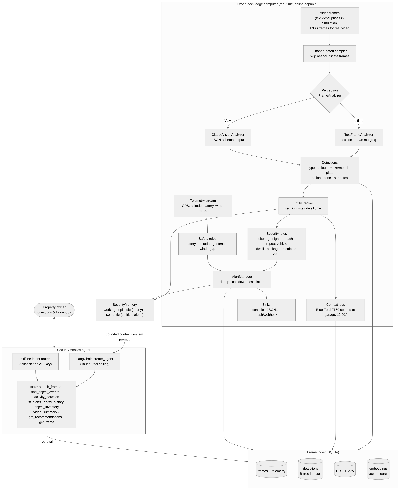

# Drone Security Analyst Agent: Prototype

A prototype of an AI agent for a **docked security drone that patrols one property**. It takes in drone
**telemetry** and **video frames** (simulated as text descriptions, or real frames sent to a VLM) and does the following:

* detects and **tracks** people, vehicles, animals and packages, and **logs them with context**
  (`Blue Ford F150 spotted at garage, 12:00.`);
* raises **real-time security and drone-safety alerts** from configurable rules
  (`Person loitering at main gate, 00:01.`);
* **indexes every frame** in SQLite. You can query the index by time, object, attribute or zone, or with full-text (BM25),
  vector or hybrid search (`show all truck events`);
* writes a **one-sentence video summary** and **prioritised recommendations**, including links it finds between events
  (*"the person who tried the garage door at 12:04 arrived in the blue F150 on its 2nd visit"*);
* answers **follow-up questions** through a LangChain tool-calling agent on Claude. When no API key is set, it uses a
  deterministic offline agent instead.

```
$ python -m drone_security demo --offline
[ALERT:HIGH] Person detected at main gate during night hours, 00:00.
[LOG] Person (dark hoodie) standing at main gate, 00:00.
[ALERT:HIGH] Person loitering at main gate, 00:01.
...
[ALERT:MEDIUM] Blue Ford F150 entered twice today, 11:58.
[LOG] Blue Ford F150 entering at main gate, 11:58 (2nd visit today).
[LOG] Blue Ford F150 spotted at garage, 12:00.
[ALERT:CRITICAL] Perimeter breach: person tampering at garage, 12:04.
...
== Video summary ==
On 26 Nov 2026 the drone analysed 1,442 frames and saw 6 vehicle visits, 7 people and 17 animals, raising
16 alerts (6 critical) - most serious: perimeter breach: person climbing at perimeter fence, 22:49; the
unrecognised Blue Ford F150 visited 2 times (08:31, 11:58).

Q: How many times did the blue Ford F150 visit today?
vehicle-002: Blue Ford F150 - 2 visit(s) at 08:31, 11:58; zones: driveway, garage, main gate
Q: When did it leave?
08:41 frame#524 Blue Ford F150 (vehicle/truck) exiting at main gate [vehicle-002]
12:06 frame#729 Blue Ford F150 (vehicle/truck) exiting at main gate [vehicle-002]
```
The complete output is in [`docs/sample_output.txt`](docs/sample_output.txt).

---

## Contents

| Deliverable | Where |
|---|---|
| Feature spec (value + key requirements) | [`docs/FEATURE_SPEC.md`](docs/FEATURE_SPEC.md) |
| Architecture, design decisions, diagrams | [`docs/ARCHITECTURE.md`](docs/ARCHITECTURE.md), [`docs/diagrams/`](docs/diagrams) |
| Testing documentation | [`docs/TESTING.md`](docs/TESTING.md), [`docs/test_results.txt`](docs/test_results.txt) |
| How AI tools were used | [`docs/AI_TOOLS.md`](docs/AI_TOOLS.md) |
| Demo video script (voice-over talking points) | [`docs/DEMO_SCRIPT.md`](docs/DEMO_SCRIPT.md) |
| PDF report | [`report/Drone_Security_Analyst_Report.pdf`](report/Drone_Security_Analyst_Report.pdf) (source: [`report/REPORT.md`](report/REPORT.md)) |
| Code | [`drone_security/`](drone_security) |
| Tests | [`tests/`](tests) (73 tests) |
| Sample data (a simulated 24 h day) | [`data/sample_day.jsonl`](data/sample_day.jsonl) |

## Setup

Requires Python 3.10+ (developed on 3.13).

```bash
git clone <this repo> && cd <repo>
python -m venv .venv && source .venv/bin/activate      # Windows: .venv\Scripts\activate
pip install -r requirements.txt                          # core + LangChain/Anthropic + pytest
```

Offline mode needs only `PyYAML` and `numpy`. Everything runs without an API key or network:
perception falls back to the text analyzer and the agent falls back to the offline router.

**Turning on the LLM agent and the VLM (optional):**

```bash
export ANTHROPIC_API_KEY=sk-ant-...    # picked up automatically by the Anthropic SDK / langchain-anthropic
```

The LLM agent and VLM both use `claude-opus-5-5`. You can override the model with the `model=` argument of
`LLMSecurityAgent` or `ClaudeVisionAnalyzer`.

## Running

```bash
# 1. End-to-end showcase: input -> logs/alerts -> summary -> recommendations -> index queries -> Q&A
python -m drone_security demo --offline          # drop --offline to use the Claude agent when a key is set

# 2. Generate the simulated day (already committed as data/sample_day.jsonl)
python -m drone_security simulate --out data/sample_day.jsonl

# 3. Process a stream "live" and persist the index
python -m drone_security run --db out/index.db               # add --speed 2 for a slow, video-friendly replay
python -m drone_security run --db out/index.db --quiet       # alerts only

# 4. Query the frame index
python -m drone_security query --db out/index.db --object truck            # "show all truck events"
python -m drone_security query --db out/index.db --object "blue ford f150"
python -m drone_security query --db out/index.db --from 00:00 --to 00:05   # by time
python -m drone_security query --db out/index.db --search "intruder with a tool"   # hybrid search
python -m drone_security query --db out/index.db --alerts --min-severity HIGH

# 5. Ask the agent (one-shot or interactive multi-turn)
python -m drone_security ask "What objects were in the video?"
python -m drone_security chat

# 6. Summary, scalability benchmark, real video
python -m drone_security summary
python -m drone_security benchmark --frames 50000
python -m drone_security video --file patrol.mp4 --fps 1 --zone "main gate"    # needs ANTHROPIC_API_KEY
```

Tests:

```bash
pytest -q                 # 73 tests, ~30 s (includes a 100k-frame scale test)
pytest -q -m "not slow"   # skip the 100k-frame test
```

## How it works (short version)



| Stage | Module | What it does |
|---|---|---|
| Input | `simulator.py`, `video.py` | Simulated 24 h day: telemetry every 30 s, one patrol frame per minute, plus a scripted ground-truth scenario. For real video, frames are sampled with change gating so near-duplicate frames are skipped. |
| Perception | `perception.py` | `TextFrameAnalyzer` is a lexicon and span-merging parser (offline, about 0.1 ms/frame). `ClaudeVisionAnalyzer` is a VLM that returns JSON-schema-constrained detections and falls back to the text parser on error or refusal. |
| Tracking | `tracker.py` | Re-identifies entities by plate, by colour+make+model, or by clothing. Counts visits (a gap of 15 min or more starts a new visit) and measures dwell time per zone. |
| Rules | `rules.py`, `config/property.yaml` | 8 security rules and 5 drone-safety rules. Thresholds, zones, night hours and authorised vehicles are set in YAML. |
| Alerting | `alerts.py` | Deduplication, a 10-minute cooldown per (rule, entity), and severity escalation that always gets through the cooldown. Output goes to console and JSONL sinks. |
| Indexing | `index.py` | SQLite tables: frames, detections, logs, alerts, telemetry. Search uses B-tree indexes, FTS5 BM25, 512-d hashed embeddings, and RRF hybrid ranking. |
| Context | `memory.py` | Three memory tiers kept within a fixed size: working memory (recent logs), episodic (hourly summaries) and semantic (entities and alerts). This keeps the LLM context around 14 k characters at any video length. |
| Agent | `agent.py`, `summarizer.py` | The LangChain `create_agent` agent on Claude has 9 grounded tools, plus an offline intent router, a one-sentence summary and cross-event recommendations. |

## Design decisions (why)

* **Rules are deterministic, and the LLM sits on top.** Alerts must be fast, explainable, testable and work offline
  on the dock. So the LLM is never on the alert path. It handles explanation, Q&A and recommendations, and it can only
  use facts the deterministic layer produced.
* **Perception is behind an interface.** The text analyzer and the Claude VLM return the same `Detection`
  dataclass, so tracking, rules, the index and the agent don't know where a detection came from. The simulation and
  real video take the same path.
* **SQLite for the index.** It needs no running service, ships with Python, and has FTS5 built in. The index is a
  single file the dock can sync. The schema maps 1:1 onto Postgres with pgvector, or OpenSearch, for a fleet.
* **Hybrid retrieval.** BM25 finds exact tokens (plates, "crowbar"). The embedding finds synonyms ("pickup" ->
  F150, "intruder" -> climbing). Reciprocal Rank Fusion combines them without tuning weights.
* **Bounded, tiered memory.** The agent doesn't receive the whole video. It gets a fixed-size briefing and retrieves
  detail with tools. This is what lets it scale from one hour to many days.
* **Every external dependency has a fallback.** No key means the offline agent. A VLM failure or refusal means the
  text analyzer for that frame. An LLM error means the agent answers offline.

The full rationale and the alternatives I considered are in [`docs/ARCHITECTURE.md`](docs/ARCHITECTURE.md).

## AI tools used

This project was built with **Claude Code** (an agentic coding CLI) driving development end to end: it read the
brief, proposed and then checked the architecture, wrote the modules and tests, ran them, and fixed the bugs the
runs exposed. The detection lexicon, the alert rules, the LangChain agent and these docs were AI-generated and then
iterated against test results. Concrete examples, including bugs the AI caught and fixed, are in
[`docs/AI_TOOLS.md`](docs/AI_TOOLS.md).

## Repository layout

```
drone_security/
  models.py        dataclasses: Telemetry, Frame, Detection, LogEntry, Alert, Severity
  config.py        site config (zones, geofence, schedule, authorised vehicles, rule params)
  simulator.py     simulated day + scripted ground-truth scenario + synthetic streams
  perception.py    TextFrameAnalyzer (offline) and ClaudeVisionAnalyzer (VLM)
  tracker.py       entity re-identification, visits, dwell time
  rules.py         security + drone-safety alert rules
  alerts.py        AlertManager (dedup/cooldown/escalation) + sinks
  index.py         SQLite frame index: structured, FTS5, vector, hybrid
  memory.py        bounded hierarchical context for the agent
  pipeline.py      SecurityPipeline orchestration + JSONL stream IO
  summarizer.py    one-sentence summary, cross-event correlation, recommendations
  agent.py         SecurityTools, LLMSecurityAgent (LangChain + Claude), OfflineSecurityAgent
  video.py         real-video frame extraction + change gating
  cli.py           command-line interface
config/property.yaml
data/sample_day.jsonl
docs/              spec, architecture, testing, AI tools, demo script, diagrams, sample outputs
report/            PDF report + markdown source
scripts/           diagram + report build scripts
tests/             pytest suite
```
