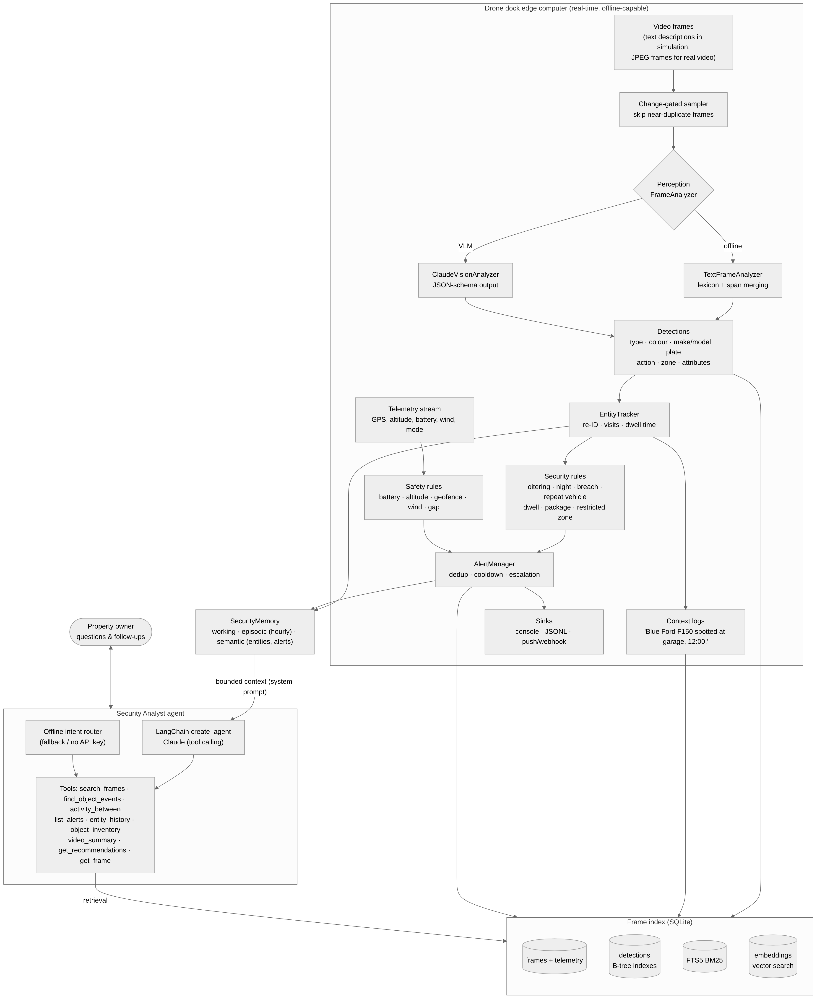
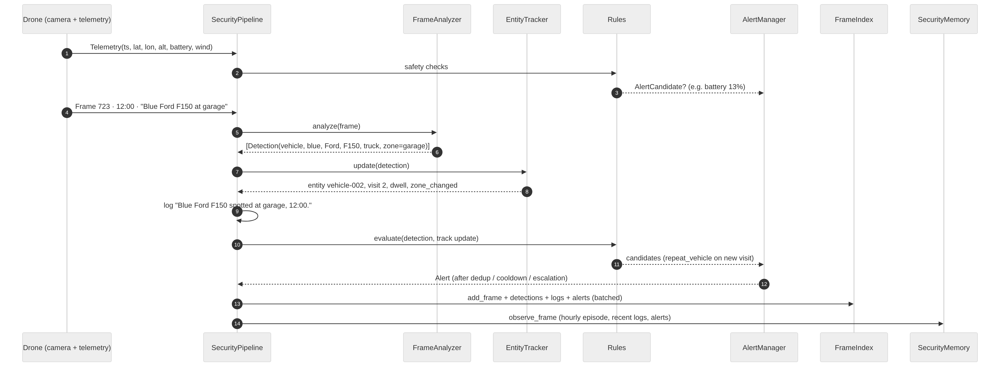
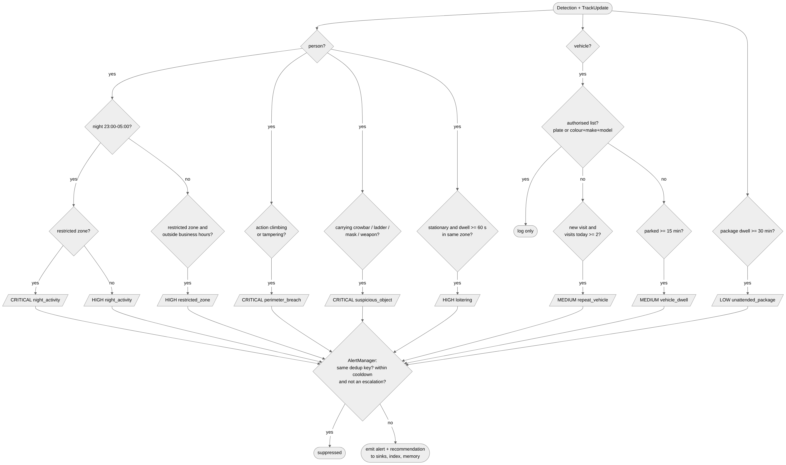
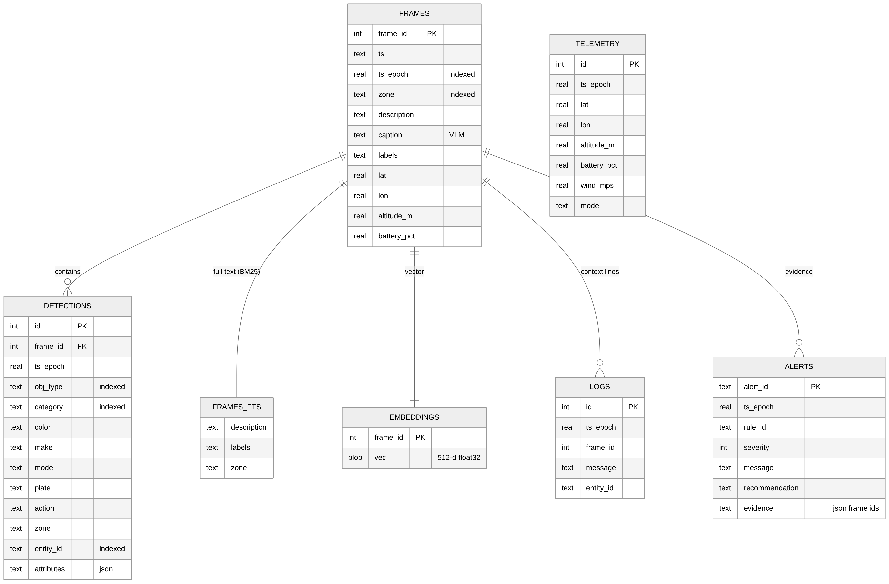
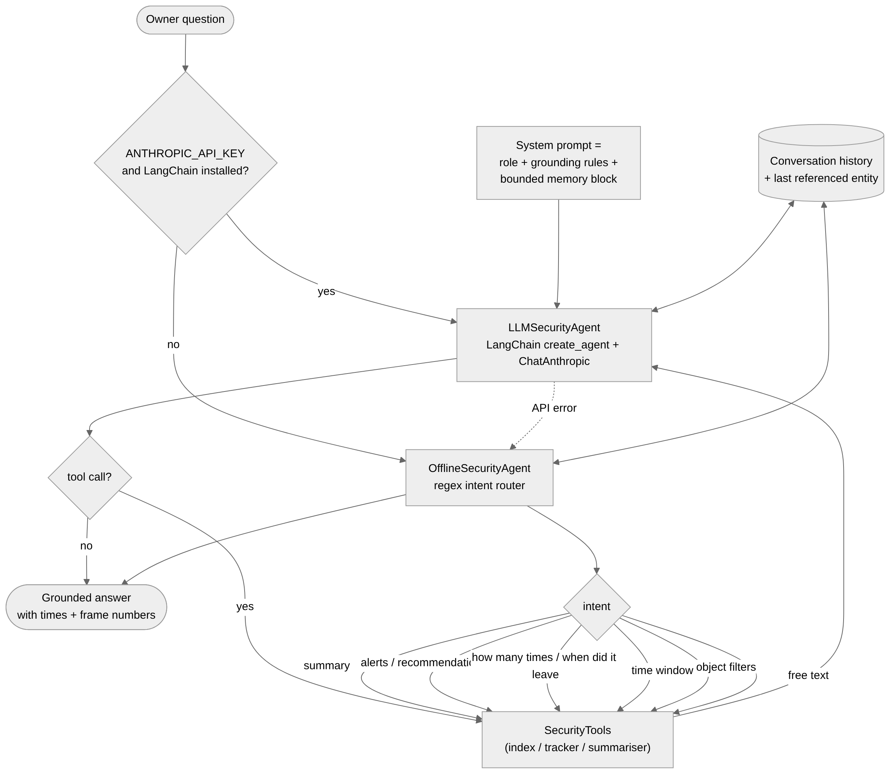

# Architecture & Design Decisions

## 1. System overview



The system runs as a **streaming pipeline on the drone dock's edge computer**, with an **analyst agent** layered on
top:

```
telemetry ─► TelemetryRules ─────────────────────────────────┐
                                                             ▼
frame ─► FrameAnalyzer ─► EntityTracker ─► DetectionRules ─► AlertManager ─► sinks (console / JSONL / push)
             │                 │                                 │
             └── detections ───┴─► LogEntry ──► FrameIndex ◄──────┘     (SQLite: B-tree, FTS5, vectors)
                                          └──► SecurityMemory ──► LLM agent system prompt
                                                                   └─► agent tools query FrameIndex
```

Per-frame data flow:



## 2. Components

### 2.1 Input: telemetry and frames (`simulator.py`, `video.py`)
* **Simulation.** `simulate_day()` produces one deterministic 24 h day with telemetry every 30 s (position, altitude,
  battery on a 40 min flight / 20 min dock cycle, wind, mode) and a patrol frame each minute for the zone the camera
  faces. On top of that sits a **scripted ground-truth scenario** of 38 events: a midnight loiterer, owner's car, a
  blue F150 that comes twice and whose driver tries the garage door, a delivery and an unattended package, an unknown
  car dwelling, an evening intrusion with a crowbar, wildlife, plus telemetry faults (datalink gap, wind gusts,
  geofence drift, low battery). Each scripted event lists the alert it should trigger, and the tests check those
  alerts.
* **Real video.** `video_to_frames()` samples frames at N fps (OpenCV, or the ffmpeg CLI as a fallback). It then
  **change-gates** them: a 32×32 grayscale thumbnail diff skips near-identical frames, with a heartbeat frame every
  30, so a static scene doesn't cost a VLM call per second. Telemetry is matched by nearest timestamp.

### 2.2 Perception (`perception.py`)
`FrameAnalyzer` is a one-method protocol, `analyze(frame) -> list[Detection]`.

| Analyzer | When | How |
|---|---|---|
| `TextFrameAnalyzer` | default, offline, tests | Splits the description into clauses. Finds object mentions (vehicle tokens are **merged across adjacent words**, so "Blue Ford F150 pickup truck" is one vehicle). Gives each mention an attribute window that runs up to the next mention. In that window it reads colour, make/model (model → make + category inference), plate (regex), person clothing and carried items, a prioritised action verb (climbing > tampering > loitering > entering/exiting > …) and the zone (longest alias, ignoring *destinations* such as "toward the shed"). Handles negation ("No vehicles at gate") and carries the zone over between clauses. |
| `ClaudeVisionAnalyzer` | real frames, or LLM parsing of text | Sends the image (base64) or the description, plus a zone hint from telemetry, to Claude with a **JSON-schema-constrained output** (`output_config.format`) and maps the result onto `Detection`. Unknown zones are normalised through the site's alias table. It uses the server-side refusal fallback. On a refusal, API error or invalid JSON it falls back to the text analyzer **for that frame only**. |

### 2.3 Tracking (`tracker.py`)
Re-identification by attributes (no appearance embeddings in a text prototype):
* **Vehicles:** by plate. Otherwise by (colour, make, model, category), all day. A sighting with a plate and one
  without are linked.
* **People:** by clothing only, within the day. Carried items like a flashlight or crowbar come and go, so they are
  excluded from the signature. Undescribed people are matched to the most recent person in the same zone within 2 min.
* **Packages:** stationary, so they never start new "visits".
* **Visits:** a gap of 15 min or more starts a new visit. **Dwell** is the continuous time in the current zone.
  These two signals drive loitering, repeat-vehicle, vehicle-dwell and unattended-package rules.

### 2.4 Rules & alerting (`rules.py`, `alerts.py`, `config/property.yaml`)


| Rule | Trigger | Default severity |
|---|---|---|
| `loitering` | stationary person, same zone, ≥ 60 s (couriers exempt) | HIGH |
| `night_activity` | any person 23:00–05:00 | HIGH, CRITICAL in restricted zone |
| `perimeter_breach` | action climbing / tampering | CRITICAL |
| `suspicious_object` | crowbar, ladder, mask, weapon, bolt cutters… | CRITICAL |
| `restricted_zone` | person in restricted zone outside business hours (not night) | HIGH |
| `repeat_vehicle` | unauthorised vehicle starts its 2nd+ visit today | MEDIUM |
| `vehicle_dwell` | unauthorised vehicle in one zone ≥ 15 min | MEDIUM |
| `unattended_package` | package in place ≥ 30 min | LOW |
| `low_battery` | ≤ 25 % warn, ≤ 15 % critical (not when docked) | MEDIUM / CRITICAL |
| `altitude` | outside 5–120 m while flying | HIGH |
| `geofence` | position outside the property rectangle | HIGH |
| `high_wind` | wind > 12 m/s while flying | MEDIUM |
| `telemetry_gap` | > 30 s without telemetry | MEDIUM |

`AlertManager` emits each `dedup_key` once. It suppresses the same rule for the same entity or zone for 10 min, **but
always lets a severity escalation through** (battery MEDIUM → CRITICAL). That bug was found by a test and fixed; see
`AI_TOOLS.md`. Every alert carries `details`, a concrete `recommendation` and evidence frame IDs.

### 2.5 Frame index (`index.py`): the cross-domain part


* **Tables:** `frames` (timestamp, zone, description or caption, telemetry snapshot, label string), `detections`
  (one row per object, indexed on type/category/time, entity and frame), `logs`, `alerts`, `telemetry`,
  `embeddings`, and an FTS5 virtual table.
* **Query paths:**
  1. structured SQL (`query_detections(category="truck")`, `frames_between("00:00","00:05")`, alerts by severity);
  2. **FTS5 BM25** with Porter stemming over description + labels;
  3. **vector search** over a 512-d feature-hashing embedding (unigrams, bigrams and a small security-domain synonym
     table) with cosine scoring in numpy. The `Embedder` protocol lets you swap in a sentence-transformer;
  4. **hybrid**: Reciprocal Rank Fusion of 2 and 3, with an **event prior**. Frames that contain detections are
     ranked before empty patrol frames, so ~180 identical "Tool shed door closed" frames can't drown the one real
     event for "intruder with a tool". When the strict (AND) keyword query finds nothing, it is relaxed to OR and
     expanded with the domain synonyms.
* **Writes** are batched (500 frames per transaction, WAL mode). Vectors are cached in memory for search.
* Times are accepted as `HH:MM` (resolved against the indexed day), ISO strings or datetimes.

### 2.6 Context management (`memory.py`)
The LLM never sees raw frames. `SecurityMemory` maintains:

| Tier | Content | Bound |
|---|---|---|
| Working | last 25 log lines | fixed |
| Episodic | one compressed line per active hour; anything older than 24 h is rolled into one line | ≤ 25 lines |
| Semantic | entity registry (most visits first) and alerts (most severe first) | 20 entities, 25 alerts |

`context_block()` goes into the system prompt as a briefing (about 14k characters whether the video is 1,442 frames or
100k). For details, the agent **retrieves** through tools instead of having everything stuffed into the prompt.

### 2.7 Agent (`agent.py`, `summarizer.py`)


* `SecurityTools` has 9 typed, read-only tools: `search_frames`, `find_object_events`, `activity_between`,
  `list_alerts`, `entity_history`, `object_inventory`, `video_summary`, `get_recommendations` and `get_frame`.
* `LLMSecurityAgent` uses LangChain `create_agent` with `ChatAnthropic(model="claude-opus-5-5", effort="medium")`.
  The system prompt sets the analyst role and grounding rules (cite times and frames, never invent identities or
  plates) and includes the memory block. Conversation history is kept for follow-ups. If an API call fails, the
  agent answers through the offline router.
* `OfflineSecurityAgent` is a regex intent router (summary, alerts, recommendations, visit counts, "when did it
  leave/arrive", time windows, object filters, frame lookup, free-text fallback) over the same tools. It resolves
  pronouns ("it", "that truck") to the last object discussed.
* `summarizer.py` produces the **one-sentence summary**. Its most-serious incident is the entity with the highest
  summed squared severity. It also runs **cross-event correlation**: a person's security alert that falls inside an
  unauthorised vehicle's visit window becomes a "suspect vehicle" finding. Recommendations are ranked by correlation,
  then alert severity, then hot-spot zones, then drone operations.

## 3. Key design decisions & alternatives considered

| Decision | Alternatives | Why this one |
|---|---|---|
| Deterministic rules decide alerts; the LLM explains and answers | LLM decides per frame | Latency, cost, offline operation, auditability, testability. A safety system must not hallucinate an alert or miss one because of sampling variance. |
| One `Detection` schema for text and VLM perception | Separate code paths | The simulation and real video share tracking, rules, index and agent. Swapping in a different VLM is a single class. |
| Claude (vision + structured output) as the VLM | CLIP, BLIP-2, YOLO + captioner | CLIP gives similarity, not structured attributes. BLIP gives a caption you'd still have to parse. A YOLO-family detector is the right production choice for boxes at frame rate but needs a separate attribute model. A strong VLM with JSON-schema output returns colour, make, model, plate, action and zone in one call, and suits change-gated or low-fps sampling. In production I'd put a fast on-dock detector first and call the VLM only on frames with objects. |
| SQLite + FTS5 + numpy vectors | Postgres + pgvector, Elasticsearch, FAISS, Chroma | Nothing to run, a single-file artefact, and it ships with Python. The query latency measured at 50k frames is single-digit ms. The schema ports directly to pgvector or OpenSearch for a fleet. |
| Feature-hashing embedding | sentence-transformers | No model download, deterministic, microseconds per frame, and good enough for the domain vocabulary. Kept behind the `Embedder` protocol so a neural model can be swapped in. |
| Tiered bounded memory + tool retrieval | Full transcript in the prompt; vector memory only | Constant prompt size as video length grows. The agent always knows the important facts (alerts, recurring entities) and can still drill down. |
| LangChain `create_agent` | Hand-rolled tool loop, Managed Agents | The brief asks for a LangChain agent. `create_agent` keeps the loop short, and the tools are plain Python functions, so the offline agent reuses them. |
| YAML site config | Hard-coded constants | The same code works on another property. Zones, schedule, authorised vehicles and thresholds are data. |

## 4. Scalability

Measured in this repo (`python -m drone_security benchmark --frames 50000`, single CPU core, no VLM):

```
Ingested 50,000 frames (15,196 detections, 2,560 alerts) in 8.84s -> 5,658 frames/s
Context block size: 14,318 chars (bounded regardless of video length)
  structured: all trucks          15.07 ms  (2027 rows)
  time window: 1 hour              1.79 ms  (500 rows)
  FTS5: 'climbing fence'           3.23 ms  (50 rows)
  vector: 'intruder'               5.27 ms  (20 rows)
  hybrid: 'pickup at gate'        27.80 ms  (20 rows)
```

A drone at 1 fps produces 86,400 frames a day. The pipeline handles a day in about 20 s, so perception (the VLM) is
the bottleneck, not the agent. That is why change gating and a detector-first cascade come first on the roadmap.
For a fleet: one pipeline per dock, the index synced to Postgres/pgvector, alerts on a message bus, and a vector ANN
index (HNSW) once there are more than a few million frames.

## 5. Failure handling

| Failure | Behaviour |
|---|---|
| No API key | Offline analyzer + offline agent, same outputs format |
| VLM error / refusal / invalid JSON | Text analyzer for that frame, warning logged |
| LLM agent error | Offline router answers the same question |
| Telemetry dropout | `telemetry_gap` alert when the link comes back |
| Alert storms | Dedup + cooldown, escalation still delivered |
