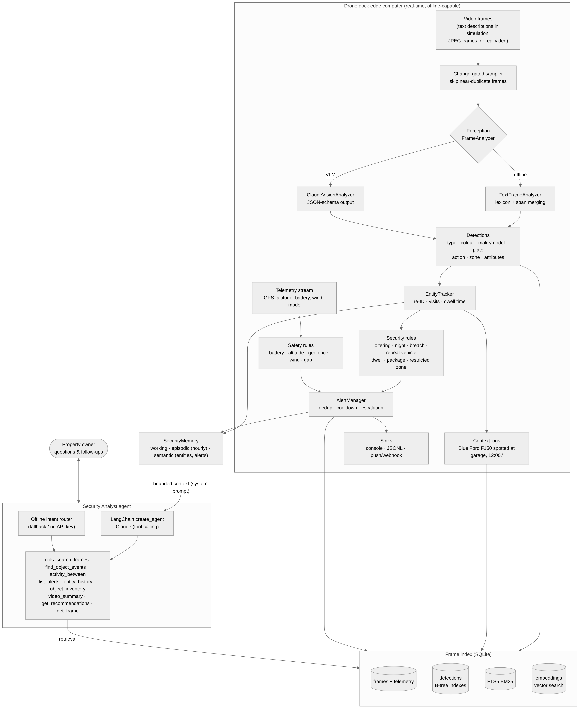
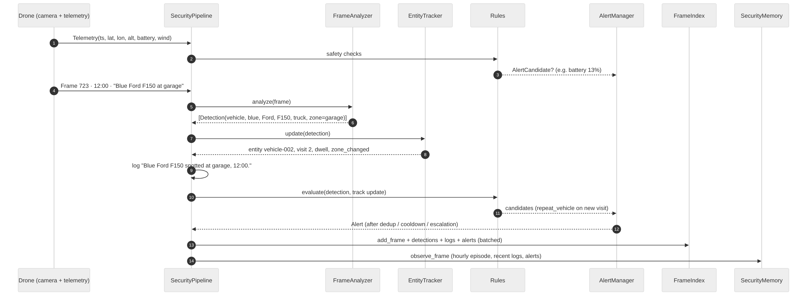

# 1. Summary

I built a working prototype of a **Drone Security Analyst Agent** for a docked drone that patrols one property. It
takes in telemetry and video frames, detects and tracks people, vehicles, animals and packages, logs them with
context, raises real-time security and drone-safety alerts, indexes every frame for search, and answers
natural-language follow-up questions. It also produces a one-sentence video summary and prioritised
recommendations.

The core design choice is a **deterministic, explainable real-time layer** (perception → tracking → rules → alerts
→ index) with an **LLM analyst layer on top** (a LangChain tool-calling agent on Claude, with a bounded, tiered memory
and retrieval tools). Everything also runs **fully offline**: a lexicon-based detector stands in for the VLM and a
rule-based router stands in for the LLM. That made it possible to test the whole system end to end against a
scripted ground-truth day.

| Metric | Result |
|---|---|
| Simulated day | 1,442 frames + 2,876 telemetry samples, 38 scripted ground-truth events |
| Alerts | 16 (6 critical), all expected; 42 duplicates suppressed; 0 on authorised vehicles, wildlife or routine frames |
| Throughput | ~5,000 frames/s on one CPU core (text perception, no VLM) |
| Index queries at 50k frames | 1.79–28 ms (structured, FTS5, vector, hybrid) |
| LLM context | ~14k characters, bounded regardless of video length (checked at 100k frames) |
| Tests | 73 passing (unit, scenario, mocked VLM, LangChain loop, scale) |

# 2. Problem framing & feature spec

**Value to property owners:** *the agent turns raw drone footage into a security analyst's notebook. It decides what
matters, says why, keeps a searchable record, and answers questions about it.* It replaces "motion detected" spam
with context-aware alerts ("person loitering at main gate at midnight", "an unknown blue F150 came back a second
time") and makes the whole day searchable.

Key requirements (full spec in `docs/FEATURE_SPEC.md`):

1. **Real-time detection, logging and alerting.** Every frame is processed on arrival. Context log lines are written
   for new entities, visits, zone changes and actions. Severity-ranked alerts come with recommendations; duplicates
   are suppressed and escalations always get through.
2. **A frame-by-frame index you can query** by time, object, attribute, zone, tracked entity, and free text (keyword
   plus semantic).
3. **A context-aware analyst agent** that gives grounded answers and follow-ups, a summary and recommendations, works
   offline, and keeps its context bounded.

# 3. Architecture

{width=78%}

| Stage | Implementation |
|---|---|
| Input | `simulator.py`: deterministic 24 h day (telemetry every 30 s, a patrol frame each minute, scripted scenario). `video.py`: real-video sampling with change gating. |
| Perception | `TextFrameAnalyzer` (lexicon + span merging) or `ClaudeVisionAnalyzer` (VLM, JSON-schema output). Both return the same `Detection`. |
| Tracking | Attribute-based re-identification (plate, then colour+make+model, then clothing), visits, dwell time |
| Rules | 8 security + 5 drone-safety rules, configured in `config/property.yaml` |
| Alerting | Dedup, a 10 min cooldown per (rule, entity), escalation bypass; console and JSONL sinks |
| Index | SQLite: frames, detections, logs, alerts, telemetry; B-tree, FTS5 BM25, 512-d vectors, RRF hybrid |
| Memory | Working (recent logs), episodic (hourly), semantic (entities, alerts): a bounded briefing |
| Agent | LangChain `create_agent` + Claude with 9 grounded tools; offline intent router fallback |

Per-frame flow:



How the architecture was arrived at and checked: I asked the AI assistant for candidate designs and then pushed back
on the obvious one, an LLM judging every frame. That design is slow, costly, cannot run offline on a dock, and is
hard to test. The final split (deterministic alerts, LLM explanation) was checked against each requirement and
against the failure modes in `ARCHITECTURE.md` §5.

# 4. Assumptions

* **Dataset.** No public dataset combines drone security video with telemetry for a single property, so, as the brief
  allows, **frames are simulated as text descriptions** ("Frame 723 | 12:00 | garage | Blue Ford F150 at garage") with
  matching telemetry. I wrote a scripted scenario that exercises every rule, and annotated it with expected outcomes
  so it doubles as ground truth.
* **Property model.** One property with 8 named zones (main gate, driveway, garage, front porch, backyard, perimeter
  fence, tool shed, parking lot), 4 of them restricted. It has a rectangular geofence, night hours 23:00–05:00,
  business hours 07:00–20:00, and an authorised-vehicle list (owner's white Tesla, gardener's green van).
* **Zone from telemetry.** When a description has no landmark, the frame takes the zone the camera is aimed at from
  telemetry.
* **Identity.** Re-identification is by appearance attributes only. No faces or identities, by design (privacy).
* **Thresholds.** Loitering at 60 s, a new visit after a 15 min gap, vehicle dwell at 15 min, package at 30 min,
  battery 25 % / 15 %, altitude ceiling 120 m (typical regulatory limit), wind 12 m/s. All are configurable.

# 5. Tool & configuration choices

**Why Claude (VLM) rather than CLIP or BLIP?** The task needs *structured attributes* (colour, make, model, plate,
action, zone, carried items) from a frame:

| Option | Gives | Gap for this task |
|---|---|---|
| CLIP | image–text similarity; good for zero-shot retrieval | No captions or attributes; you'd have to enumerate every label. Useful later as an image-embedding index. |
| BLIP / BLIP-2 | free-text caption | The caption still needs parsing; weak at plates, makes and actions; no schema guarantee |
| YOLO-family detector | fast boxes and classes at frame rate | No fine attributes or actions; needs a second model |
| **Claude vision + JSON-schema output** | caption **and** typed detections in one call; follows the site's zone vocabulary | Slower and costlier per frame, so it is paired with change gating (and, in production, a detector-first cascade) |

So the VLM path asks Claude (`claude-opus-5-5`, low effort for per-frame extraction) for a caption and a list of
detections constrained by a JSON schema. The server-side refusal fallback is enabled. On any error, refusal or
invalid JSON, that frame drops back to the text analyzer, so the pipeline never stalls. Because the output is the
same `Detection` dataclass, nothing downstream changes.

**Why this agent design?** A LangChain `create_agent` tool-calling agent (the brief asks for LangChain) on Claude
(`claude-opus-5-5`, medium effort):

* **Grounding by tools, not prompt stuffing.** Nine read-only tools wrap the index, tracker and summariser. The system
  prompt tells the agent to cite times and frame numbers and never to invent plates or identities.
* **Bounded tiered memory.** The system prompt carries a fixed-size briefing: all alerts (most severe first),
  recurring entities, hourly episodes and recent logs. That is enough to answer "what happened today?" directly. For
  detail, the agent calls tools.
* **Conversation history** is kept, so follow-ups ("when did it leave?") work.
* **An offline twin.** The same tools behind a regex intent router (with pronoun resolution) answer without an API
  key and act as the fallback on API errors.

**Why SQLite + FTS5 + hashed vectors?** There is nothing to run and the index is a single file the dock can sync. FTS5
gives BM25 keyword ranking with stemming. A 512-d feature-hashing embedding with a security-domain synonym table
handles paraphrase ("pickup" → F150, "intruder" → climbing) without downloading a model. Reciprocal Rank Fusion
combines the two rankings without weight tuning. The schema maps directly to Postgres + pgvector for a fleet.

# 6. Results

## 6.1 Frame descriptions → detections and logs

| Frame (simulated description) | Detections | Log line |
|---|---|---|
| 514 · 08:31 · "Blue Ford F150 pickup truck entering through main gate" | vehicle, blue, Ford, F150, truck, entering, main gate | `Blue Ford F150 entering at main gate, 08:31.` |
| 721 · 11:58 · "Blue Ford F150 entering through main gate" | same entity, visit 2 | `Blue Ford F150 entering at main gate, 11:58 (2nd visit today).` |
| 723 · 12:00 · "Blue Ford F150 at garage" | vehicle-002 at garage | **`Blue Ford F150 spotted at garage, 12:00.`** |
| 684–686 · "White delivery van …; courier in yellow vest carrying a package …" | van + courier + package | `Package left at front porch, 11:22.` |
| 1372 · 22:49 · "Person in black jacket climbing perimeter fence carrying a crowbar" | person, black jacket, crowbar, climbing | `Person (black jacket, crowbar) climbing at perimeter fence, 22:49.` |

## 6.2 Real-time alerts (full simulated day)

```
00:00 HIGH      Person detected at main gate during night hours, 00:00.
00:01 HIGH      Person loitering at main gate, 00:01.
11:58 MEDIUM    Blue Ford F150 entered twice today, 11:58.
12:02 LOW       Package left unattended at front porch for 40m 00s, 12:02.
12:04 CRITICAL  Perimeter breach: person tampering at garage, 12:04.
13:02 MEDIUM    Telemetry gap of 150s ended, 13:02.
15:20 MEDIUM    High wind 14 m/s, 15:20.
16:45 HIGH      Drone outside property geofence (40.00210, -75.00008), 16:45.
18:36 MEDIUM    Unrecognised Red Toyota Camry parked at parking lot for 16m 00s, 18:36.
19:38 MEDIUM    Drone battery low (22%), 19:38.
19:46 CRITICAL  Drone battery critical (13%), 19:46.          <- escalation inside the cooldown
22:47 HIGH      Person in restricted zone perimeter fence after hours, 22:47.
22:49 CRITICAL  Perimeter breach: person climbing at perimeter fence, 22:49.
22:49 CRITICAL  Person with crowbar at perimeter fence, 22:49.
23:05 CRITICAL  Person detected at tool shed during night hours, 23:05.
23:05 CRITICAL  Perimeter breach: person tampering at tool shed, 23:05.
```

There were no alerts for the owner's Tesla, the gardener's van, the courier, the fox, deer or cats, or the ~1,400
routine patrol frames.

## 6.3 Indexed frames: queries

```
> show all truck events                      (query_detections(category="truck"))
08:31 frame#514 Blue Ford F150 entering at main gate
08:33 frame#516 Blue Ford F150 parked at driveway
08:41 frame#524 Blue Ford F150 exiting at main gate
11:58 frame#721 Blue Ford F150 entering at main gate
12:00 frame#723 Blue Ford F150 seen at garage
12:06 frame#729 Blue Ford F150 exiting at main gate

> hybrid search "intruder with a tool"       (BM25 + vector, RRF)
22:49 frame#1372 [perimeter fence] Person in black jacket climbing perimeter fence carrying a crowbar
23:05 frame#1388 [tool shed] Person in black jacket prying the tool shed door with a crowbar
```

## 6.4 Video summary (bonus) and agent recommendations

> *On 26 Nov 2026 the drone analysed 1,442 frames and saw 6 vehicle visits, 7 people and 17 animals, raising 16 alerts
> (6 critical) - most serious: perimeter breach: person climbing at perimeter fence, 22:49; the unrecognised Blue Ford
> F150 visited 2 times (08:31, 11:58).*

The top recommendation comes from **cross-event correlation**: the agent noticed that the 12:04 garage tampering
happened during the F150's second visit.

> *Treat as a suspect vehicle: Perimeter breach: person tampering at garage, 12:04 happened during visit 2 of the
> Blue Ford F150 (11:58-12:06); the vehicle's occupant is the likely subject. Share plate/footage with security and
> add it to the watch-list.*

## 6.5 Follow-up questions (bonus)

```
Q: How many times did the blue Ford F150 visit today?
vehicle-002: Blue Ford F150 - 2 visit(s) at 08:31, 11:58; zones: driveway, garage, main gate
  visit 1: 08:31-08:41, zones main gate, driveway, frames [514, 516, 524]
  visit 2: 11:58-12:06, zones main gate, garage, frames [721, 723, 729]
Q: When did it leave?
08:41 frame#524 Blue Ford F150 (vehicle/truck) exiting at main gate [vehicle-002]
12:06 frame#729 Blue Ford F150 (vehicle/truck) exiting at main gate [vehicle-002]
```

(These outputs come from the offline agent. With `ANTHROPIC_API_KEY` set, the same questions go to the Claude agent,
which calls the same tools and writes prose answers.)

## 6.6 Scalability

```
Ingested 50,000 frames (15,196 detections, 2,560 alerts) in 8.84s -> 5,658 frames/s
Context block size: 14,318 chars (bounded regardless of video length)
  structured: all trucks          15.07 ms     time window: 1 hour   1.79 ms
  FTS5: 'climbing fence'           3.23 ms     vector: 'intruder'    5.27 ms
  hybrid: 'pickup at gate'        27.80 ms
```

A full day at 1 fps (86,400 frames) is processed in about 20 s, so the agent and index are not the bottleneck;
perception is.

## 6.7 Videos

| Video | Link |
|---|---|
| 1. Video processing & frame descriptions | _add link_ |
| 2. Real-time logs & alerts | _add link_ |
| 3. Frame indexing & queries | _add link_ |
| 4. Context summaries | _add link_ |
| 5. Agent recommendations & follow-up Q&A | _add link_ |
| 6. Scalability test | _add link_ |

The shot list and talking points are in `docs/DEMO_SCRIPT.md`.

# 7. Validation

73 automated tests (`docs/TESTING.md`) cover every alert rule and its boundaries; the full-day scenario in both
directions (every expected alert fires, nothing else does); index queries (structured, time, FTS, semantic, hybrid,
persistence); agent Q&A including follow-ups; the **real LangChain `create_agent` loop** driven by a scripted chat
model that makes a real tool call; the Claude VLM request and response mapping against a mocked client, plus its
refusal and error fallbacks; and scale (throughput, latency, bounded context at 100k frames). Running the system and
reading the output found seven real defects, all fixed. Examples are a person-noun false positive that caused about 30
spurious alerts, and a battery CRITICAL alert swallowed by a cooldown.

**Not validated:** live Claude API calls (no key in the build environment; covered by mocks), and detection
accuracy on real footage.

# 8. What I would do with more time

1. **Real footage and evaluation.** Put a fast on-dock detector (YOLO-class) in front of the VLM as a cascade. Build a
   labelled clip set and report precision and recall per rule, plus alert latency.
2. **Better re-identification.** Use appearance embeddings (CLIP/DINO crops) and plate OCR instead of attribute
   matching. Track across the camera's zone changes with Kalman/ByteTrack.
3. **Image-embedding search.** Store CLIP image vectors next to the text vectors, so "a person carrying something
   long" works without a caption. Move to pgvector or HNSW past a few million frames.
4. **Video summarisation.** Add clip-level LLM summaries per incident (a short narrative with key frames), and a
   daily digest pushed to the owner.
5. **Learning from feedback.** Let the owner mark alerts as useful or noise, and tune thresholds per zone and time.
   Learn "normal" schedules (the gardener's weekly visit) so repeat-vehicle alerts adapt.
6. **Agent actions.** Let the agent request drone manoeuvres (re-route to a zone, hover, spotlight) through a
   human-confirmed action tool, and send notifications (push, SMS, webhook) with escalation policies.
7. **Ops.** Streaming ingestion (MQTT or Kafka), a dashboard, multi-drone fleets, and retention and privacy controls.

# 9. How AI tools helped

The prototype was built with **Claude Code** (an agentic coding CLI) as the main implementer, with the work steered
and reviewed through its outputs. Concretely:

* **Planning and architecture.** It turned the PDF brief into a module plan and the deliverables checklist, and
  compared design alternatives (LLM-per-frame vs a deterministic rules layer; CLIP, BLIP or a VLM; SQLite vs a vector
  DB).
* **Generated components.** It wrote the object-detection logic (lexicons, span merging, action priorities,
  negation), the alert rules and recommendation texts, the LangChain agent and its tools, the hashing embedder, the
  simulated scenario, and the tests.
* **Learning a new area.** FTS5 and BM25, Reciprocal Rank Fusion, and feature hashing for embeddings were
  implemented and explained along the way (see `index.py`).
* **API correctness.** Before writing LLM code it checked the current Claude API (structured outputs, refusal
  fallback) and the installed LangChain 1.x signatures (`create_agent`, `ChatAnthropic`), instead of relying on
  possibly stale knowledge.
* **Debugging loop.** It ran the whole day, read the alert list, and fixed seven defects (listed in
  `docs/AI_TOOLS.md`). It also caught its own overstated performance claim by measuring.

Where the AI was wrong: its first draft produced noisy alerts (47 instead of 16) and had brittle re-identification.
Running the scenario and reading the output critically is what caught those problems.

_Candidate's note: add your own experience level with LangChain, VLMs and indexing here, plus which AI suggestions
you accepted, changed or rejected._
